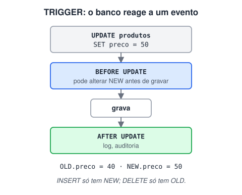

# Triggers

> 🗺️ **Nesta aula:** o que é uma trigger, a diferença entre `BEFORE` e `AFTER`, `NEW` e `OLD`, a sintaxe do MySQL com `DELIMITER`, três exemplos práticos e os cuidados ao usar triggers.

## De onde paramos

As restrições bloqueiam dados inválidos. Às vezes, porém, queremos que o banco **faça** algo automaticamente quando os dados mudam: registrar um histórico, atualizar o estoque, preencher uma data.

## O que é uma trigger

**Uma trigger (gatilho) é um bloco de SQL associado a uma tabela que o banco executa automaticamente quando acontece um** `INSERT`**,** `UPDATE` **ou** `DELETE` **nela**, antes ou depois da operação.



> 💡 **Analogia:** pense numa carta indo para o correio. A trigger **BEFORE** é o revisor que lê a carta antes de ela ser enviada e pode corrigir um erro no endereço (alterar `NEW`). A trigger **AFTER** é o funcionário que, depois do envio, anota no livro de registros o que saiu e avisa o estoque de envelopes. Ninguém precisa pedir: os dois agem sozinhos toda vez que uma carta passa.

## BEFORE × AFTER

|  | BEFORE | AFTER |
| --- | --- | --- |
| Quando roda | antes de gravar a linha | depois de gravar |
| Pode alterar `NEW`? | ✅ sim (`SET NEW.coluna = ...`) | ❌ não |
| Usos típicos | validar, normalizar, preencher colunas | auditoria, atualizar outra tabela, estoque |

Dentro da trigger:

- `NEW` = a linha com os valores novos (existe em INSERT e UPDATE);
- `OLD` = a linha como era antes (existe em UPDATE e DELETE).

## Sintaxe (MySQL)

```sql
-- troca o ";" final para o bloco não ser
-- cortado no primeiro ponto e vírgula
DELIMITER $$

CREATE TRIGGER nome_trigger
{BEFORE | AFTER} {INSERT | UPDATE | DELETE}
ON nome_tabela
FOR EACH ROW
BEGIN
  -- comandos, cada um terminando com ;
END$$

DELIMITER ;
```

## Exemplo 1: atualizar a data de modificação

```sql
DELIMITER $$
CREATE TRIGGER trg_clientes_atualizado
BEFORE UPDATE ON clientes
FOR EACH ROW
BEGIN
  SET NEW.atualizado_em = CURRENT_TIMESTAMP;
END$$
DELIMITER ;
```

No MySQL, o mesmo resultado sai sem trigger: `atualizado_em TIMESTAMP DEFAULT CURRENT_TIMESTAMP ON UPDATE CURRENT_TIMESTAMP`.

## Exemplo 2: histórico de preços (auditoria)

```sql
CREATE TABLE historico_precos (
  id           INT PRIMARY KEY AUTO_INCREMENT,
  produto_id   INT,
  preco_antigo DECIMAL(10, 2),
  preco_novo   DECIMAL(10, 2),
  alterado_em  TIMESTAMP DEFAULT CURRENT_TIMESTAMP
);

DELIMITER $$
CREATE TRIGGER trg_produtos_preco
AFTER UPDATE ON produtos
FOR EACH ROW
BEGIN
  IF OLD.preco <> NEW.preco THEN
    INSERT INTO historico_precos
      (produto_id, preco_antigo, preco_novo)
    VALUES (NEW.id, OLD.preco, NEW.preco);
  END IF;
END$$
DELIMITER ;
```

## Exemplo 3: baixar o estoque

```sql
DELIMITER $$
CREATE TRIGGER trg_itens_baixa_estoque
AFTER INSERT ON itens_pedido
FOR EACH ROW
BEGIN
  UPDATE produtos
  SET estoque = estoque - NEW.quantidade
  WHERE id = NEW.produto_id;
END$$
DELIMITER ;
```

## Cuidados

- Triggers são **"invisíveis"**: quem lê o código da aplicação não vê que um `INSERT` dispara outras coisas. Documente bem.
- Regras de negócio complexas costumam ficar melhor na **aplicação**; triggers brilham em auditoria e integridade.
- Uma trigger lenta deixa **todas** as operações na tabela lentas.
- Comandos úteis: `SHOW TRIGGERS;` e `DROP TRIGGER nome;`.

> ⚠️ **Correção importante:** o exemplo original era um `AFTER UPDATE ON Clientes` que fazia `UPDATE Clientes` **na própria tabela**. No MySQL isso gera o erro *"Can't update table 'Clientes' in stored function/trigger because it is already used by statement"*; em outros bancos, poderia disparar a trigger em loop. O correto é uma trigger **BEFORE UPDATE** com `SET NEW.coluna = ...`. Também faltava o `DELIMITER`.

## Exercício

Crie uma trigger que impeça cadastrar um produto com preço negativo, trocando o valor por 0 antes de gravar.

<details>
<summary>Ver resposta</summary>

```sql
DELIMITER $$
CREATE TRIGGER trg_produtos_preco_minimo
BEFORE INSERT ON produtos
FOR EACH ROW
BEGIN
  IF NEW.preco < 0 THEN
    SET NEW.preco = 0;
  END IF;
END$$
DELIMITER ;
```

Precisa ser `BEFORE`, porque só antes da gravação dá para alterar `NEW`. Se a ideia for recusar o cadastro, um `CHECK (preco >= 0)` é mais simples.

</details>

## 🧠 Revisão rápida

**Qual tipo de trigger pode alterar `NEW`?**

`BEFORE`.

**Em um DELETE, existe `NEW`?**

Não. Só `OLD`.

**Para que serve o `DELIMITER` no MySQL?**

Para o cliente não cortar o bloco da trigger no primeiro `;`.

> ➡️ **Próximo passo:** deixar as consultas rápidas mesmo com milhões de linhas: **Índices e desempenho**.

## 📌 Resumo

| Item | Em uma frase |
| --- | --- |
| Trigger | SQL executado automaticamente num evento |
| `BEFORE` | antes de gravar; pode alterar `NEW` |
| `AFTER` | depois de gravar; auditoria e efeitos |
| `NEW` / `OLD` | valores novos / antigos |
| `DELIMITER` | necessário no MySQL para blocos |
| Cuidado | triggers são invisíveis para a aplicação |
