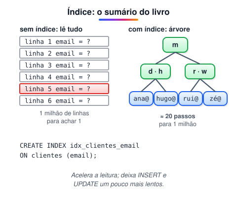

# Índices e desempenho (Adicionado pelo aluno para melhorar o estudo)

> 🗺️ **Nesta aula:** o que é um índice, como criar índices simples, únicos e compostos, quando eles ajudam ou são ignorados, seu custo, como ler o plano com `EXPLAIN` e outras dicas de desempenho.

## De onde paramos

Suas consultas funcionam, mas com poucas linhas tudo é rápido. Com milhões de registros, uma busca por e-mail pode levar segundos. Índices resolvem isso.

## O que é um índice

**Um índice é uma estrutura auxiliar que permite ao banco achar linhas sem ler a tabela inteira.** Na maioria dos bancos ele é uma **árvore B (B-tree)** ordenada pelos valores da coluna.



> 💡 **Analogia:** é o índice remissivo no fim de um livro de biologia. Sem ele, para achar "fotossíntese" você folheia as 500 páginas (a varredura completa). Com ele, vai direto à letra F e lê "página 212". O preço: toda vez que o livro ganha um capítulo novo, alguém precisa atualizar o índice, e ele ocupa páginas extras. Por isso índices aceleram a leitura, mas deixam a escrita um pouco mais lenta.

## Criando

```sql
CREATE INDEX idx_clientes_email ON clientes(email);

-- também impede repetição
CREATE UNIQUE INDEX uq_usuarios_login ON usuarios(login);

-- índice composto: a ORDEM das colunas importa
CREATE INDEX idx_pedidos_cliente_data
  ON pedidos(cliente_id, data_pedido);

-- MySQL
DROP INDEX idx_clientes_email ON clientes;
```

`PRIMARY KEY` e `UNIQUE` já criam um índice automaticamente. No MySQL (InnoDB), as **chaves estrangeiras** também ganham um índice; no PostgreSQL, **não**, então crie você mesmo.

## Quando o índice ajuda

- Colunas usadas em `WHERE`, `JOIN ... ON`, `ORDER BY` e `GROUP BY`.
- Colunas com **muitos valores diferentes** (alta seletividade): e-mail, CPF, data. Um índice em `ativo` (só true/false) quase nunca compensa.
- Um índice composto `(cliente_id, data_pedido)` serve para buscas por `cliente_id` sozinho ou por `cliente_id` e `data_pedido` juntos, mas **não** por `data_pedido` sozinha (regra do prefixo à esquerda).

## Quando o índice NÃO é usado

```sql
-- função na coluna → não usa o índice
WHERE YEAR(data_pedido) = 2023
-- ✅ mesmo filtro, usa o índice
WHERE data_pedido >= '2023-01-01'
  AND data_pedido <  '2024-01-01'

-- curinga no início → não usa
WHERE nome LIKE '%silva'
-- ✅ usa
WHERE nome LIKE 'silva%'
```

## O custo

Índices **aceleram leituras** e **deixam escritas mais lentas**: cada `INSERT`, `UPDATE` e `DELETE` também atualiza todos os índices da tabela, e eles ocupam espaço em disco. Crie índices para as consultas reais do sistema, e não "em tudo".

## `EXPLAIN`: veja o plano da consulta

```sql
EXPLAIN SELECT * FROM clientes
WHERE email = 'ana@ex.com';
```

No MySQL, observe a coluna `type`: `ALL` significa varredura completa (ruim em tabelas grandes); `ref`, `eq_ref` ou `const` indicam uso de índice. A coluna `key` mostra qual índice foi escolhido.

## Outras dicas de desempenho

- Selecione só as colunas necessárias, em vez de `SELECT *`.
- Pagine com `LIMIT`.
- Evite o problema **N+1**: buscar 100 pedidos e depois fazer 100 consultas, uma para cada cliente. Use um JOIN.

## Exercício

A consulta abaixo é lenta numa tabela com 5 milhões de pedidos. Proponha um índice e reescreva o filtro para que ele seja usado.

```sql
SELECT id, total
FROM pedidos
WHERE cliente_id = 42
  AND MONTH(data_pedido) = 3
  AND YEAR(data_pedido) = 2024;
```

<details>
<summary>Ver resposta</summary>

```sql
CREATE INDEX idx_pedidos_cliente_data
  ON pedidos(cliente_id, data_pedido);

SELECT id, total
FROM pedidos
WHERE cliente_id = 42
  AND data_pedido >= '2024-03-01'
  AND data_pedido <  '2024-04-01';
```

Trocar as funções por um intervalo permite usar o índice composto: primeiro filtra pelo cliente, depois pela faixa de datas.

</details>

## 🧠 Revisão rápida

**Qual o custo de ter muitos índices?**

Escritas mais lentas e mais espaço em disco.

**Um índice em `(a, b)` serve para buscar só por `b`?**

Não. Só por `a` ou por `a` e `b`.

**O que `type = ALL` no EXPLAIN indica?**

Varredura completa da tabela, sem índice.

> ➡️ **Próximo passo:** garantir que várias operações aconteçam juntas ou não aconteçam: **Transações e ACID**.

## 📌 Resumo

| Item | Em uma frase |
| --- | --- |
| Índice | sumário que evita ler a tabela inteira |
| B-tree | estrutura mais comum |
| Composto | a ordem das colunas importa |
| Função na coluna | impede o uso do índice |
| `LIKE '%x'` | curinga no início não usa índice |
| Custo | escrita mais lenta, mais espaço |
| `EXPLAIN` | mostra o plano da consulta |
