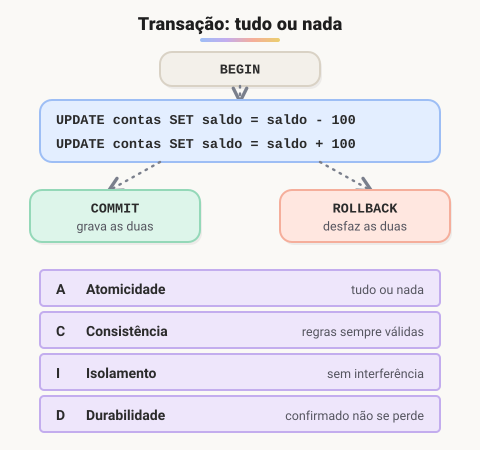

# Transações e ACID

> 🗺️ **Nesta aula:** o que é uma transação, os comandos `START TRANSACTION`, `COMMIT`, `ROLLBACK` e `SAVEPOINT`, as garantias ACID, os níveis de isolamento e como usar transações numa aplicação Node.js.

## De onde paramos

Os índices deixam as consultas rápidas. Falta garantir que operações que precisam acontecer **juntas** nunca fiquem pela metade, mesmo que o servidor caia no meio.

## O que é uma transação

**Uma transação agrupa vários comandos em uma unidade: ou todos são gravados, ou nenhum é.** O exemplo clássico é uma transferência bancária: tirar o dinheiro de uma conta e colocar na outra precisa acontecer **junto**. Se o sistema cair no meio, o dinheiro não pode sumir.



## Comandos (TCL)

```sql
-- ou BEGIN
START TRANSACTION;

UPDATE contas SET saldo = saldo - 100 WHERE id = 1;
UPDATE contas SET saldo = saldo + 100 WHERE id = 2;

-- conferiu e está tudo certo? grava
COMMIT;

-- deu algo errado? desfaz tudo desde o início
ROLLBACK;
```

`SAVEPOINT nome` cria um ponto intermediário, e `ROLLBACK TO nome` volta só até ele.

> 💡 Por padrão, MySQL e PostgreSQL estão em **autocommit**: cada comando solto é uma transação que se confirma sozinha. O `START TRANSACTION` desliga isso até o próximo `COMMIT` ou `ROLLBACK`. No MySQL, comandos DDL (`CREATE`, `DROP`, `ALTER`) fazem **commit implícito** e não podem ser desfeitos.

## ACID: as quatro garantias

| Letra | Propriedade | Significa |
| --- | --- | --- |
| **A** | Atomicidade | tudo ou nada: sem transferência pela metade |
| **C** | Consistência | vai de um estado válido a outro, respeitando PK, FK e CHECK |
| **I** | Isolamento | transações simultâneas não veem dados pela metade |
| **D** | Durabilidade | depois do `COMMIT`, o dado sobrevive a uma queda |

## Níveis de isolamento

Isolamento total custa desempenho, então os bancos oferecem níveis:

| Nível | Evita |
| --- | --- |
| `READ UNCOMMITTED` | nada (pode ler dados não confirmados, o *dirty read*) |
| `READ COMMITTED` | leitura suja (padrão do PostgreSQL e do SQL Server) |
| `REPEATABLE READ` | leitura suja e leituras que mudam no meio da transação (padrão do MySQL/InnoDB) |
| `SERIALIZABLE` | tudo: como se as transações rodassem uma depois da outra |

## Na aplicação (Node.js com mysql2)

```jsx
const conn = await pool.getConnection();
try {
  await conn.beginTransaction();
  await conn.query(
    "UPDATE contas SET saldo = saldo - ? WHERE id = ?",
    [100, 1]
  );
  await conn.query(
    "UPDATE contas SET saldo = saldo + ? WHERE id = ?",
    [100, 2]
  );
  await conn.commit();
} catch (erro) {
  // qualquer erro desfaz as duas operações
  await conn.rollback();
  throw erro;
} finally {
  conn.release();
}
```

> ⚠️ Repare nos `?`: são **parâmetros**. Nunca monte SQL concatenando texto digitado pelo usuário (`"... WHERE nome = '" + nome + "'"`), porque isso abre brecha para **SQL Injection**: alguém pode digitar um trecho de SQL e apagar ou vazar dados.

## Exercício

Escreva em SQL uma compra que: (1) cria o pedido 50 para o cliente 7; (2) insere o item (produto 3, quantidade 2, preço 39.90); (3) baixa o estoque do produto. Tudo deve ser desfeito se algo falhar.

<details>
<summary>Ver resposta</summary>

```sql
START TRANSACTION;

INSERT INTO pedidos (id, cliente_id, data_pedido)
VALUES (50, 7, CURRENT_DATE);

INSERT INTO itens_pedido
  (pedido_id, produto_id, quantidade, preco_unit)
VALUES (50, 3, 2, 39.90);

UPDATE produtos
SET estoque = estoque - 2
WHERE id = 3 AND estoque >= 2;

-- se o UPDATE não afetou nenhuma linha
-- (estoque insuficiente), a aplicação faz ROLLBACK;
-- senão:
COMMIT;
```

A condição `estoque >= 2` evita estoque negativo; a aplicação confere quantas linhas o `UPDATE` afetou para decidir entre `COMMIT` e `ROLLBACK`.

</details>

## 🧠 Revisão rápida

**O que garante a atomicidade?**

Que todos os comandos da transação sejam gravados, ou nenhum.

**O que é autocommit?**

Cada comando solto é confirmado automaticamente.

**Como evitar SQL Injection?**

Usando consultas parametrizadas (`?`) em vez de concatenar texto.

> ➡️ **Próximo passo:** fim do curso! Volte ao índice para revisar o **Resumo do curso** e escolher seu próximo projeto.

## 📌 Resumo

| Item | Em uma frase |
| --- | --- |
| Transação | tudo ou nada |
| `COMMIT` | confirma |
| `ROLLBACK` | desfaz |
| `SAVEPOINT` | ponto de retorno parcial |
| ACID | atomicidade, consistência, isolamento, durabilidade |
| Isolamento | níveis trocam segurança por desempenho |
| Parâmetros `?` | evitam SQL Injection |
