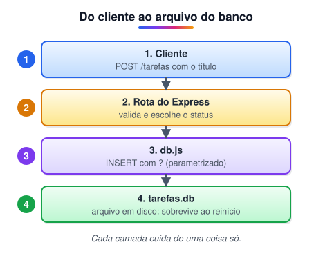

# Integrando Node.js e SQL: API com banco de dados (Adicionado pelo aluno para melhorar o estudo)

> 🗺️ **Nesta aula:** como ligar a API do Express a um banco SQL (SQLite), criando a tabela, lendo, inserindo, alterando e apagando registros com comandos parametrizados, e por que nunca montar SQL juntando texto.

## De onde paramos

Você construiu uma API com Express que guardava as tarefas em um array, e aprendeu SQL para criar tabelas, inserir e consultar dados. Falta juntar as duas peças: a API guardando os dados em um banco de verdade. Este é o passo que transforma o conteúdo das aulas em uma aplicação *full stack*.

## Por que sair da memória

Uma API que guarda os dados em um array perde tudo quando o servidor reinicia, e não consegue dividir os dados entre vários servidores. Um **banco de dados guarda os dados em disco, de forma organizada e consultável, e sobrevive a reinicializações**. Para aprender, usaremos o SQLite, um banco que cabe em um único arquivo e já vem embutido no Node 22 ou superior, pelo módulo `node:sqlite`. O SQL que você aprendeu vale igual para PostgreSQL ou MySQL; muda só a forma de conectar.

> 💡 **Analogia:** guardar em um array é anotar o pedido na mão: ao fechar o restaurante, a anotação some. O banco é o livro-caixa arquivado na prateleira: o garçom (a API) vai até ele para ler e escrever, e o livro continua lá no dia seguinte.

## A camada de acesso ao banco

Uma boa prática é isolar tudo o que fala com o banco em um arquivo, e deixar as rotas apenas chamando funções com nomes claros. Assim, trocar o banco no futuro mexe em um único lugar.



> 💡 **Analogia:** é uma lanchonete: o caixa (a rota) confere e anota o pedido, a cozinha (o `db.js`) o executa seguindo a receita, e a câmara fria (o arquivo do banco) guarda o que sobra para o dia seguinte. O cliente nunca entra na cozinha.

O código da camada de dados:

```jsx
// db.js
import { DatabaseSync } from "node:sqlite";

// abre (ou cria) o arquivo do banco
const db = new DatabaseSync("tarefas.db");

// cria a tabela só se ela ainda não existir
db.exec(`
  CREATE TABLE IF NOT EXISTS tarefas (
    id INTEGER PRIMARY KEY AUTOINCREMENT,
    titulo TEXT NOT NULL,
    feita INTEGER NOT NULL DEFAULT 0
  )
`);

export function listar() {
  return db
    .prepare("SELECT * FROM tarefas ORDER BY id")
    .all();
}

export function criar(titulo) {
  // os "?" recebem os valores com segurança
  const r = db
    .prepare("INSERT INTO tarefas (titulo) VALUES (?)")
    .run(titulo);
  const id = Number(r.lastInsertRowid);
  return { id, titulo, feita: 0 };
}

export function concluir(id) {
  const r = db
    .prepare("UPDATE tarefas SET feita = 1 WHERE id = ?")
    .run(id);
  return r.changes > 0; // false se o id não existe
}

export function remover(id) {
  const r = db
    .prepare("DELETE FROM tarefas WHERE id = ?")
    .run(id);
  return r.changes > 0;
}
```

Repare nas peças. A tabela usa o que você já conhece de DDL: chave primária autoincrementada, `NOT NULL` e `DEFAULT`. O método `.all()` devolve todas as linhas; `.run()` executa uma alteração e informa quantas linhas foram afetadas (`changes`) e o id gerado (`lastInsertRowid`). O `changes` é o que permite responder “não encontrado” quando o id não existe.

## O perigo de montar SQL com texto

A tentação de iniciante é escrever `"INSERT ... VALUES ('" + titulo + "')"`. Se o usuário digitar um título com aspas e comandos SQL, o texto dele vira parte do comando: é a **injeção de SQL**, uma das falhas de segurança mais antigas e mais graves da web. A solução é o **comando parametrizado**: o SQL fica fixo, com `?` no lugar dos valores, e o banco recebe os valores à parte, sempre tratados como dados, nunca como código.

> ⚠️ **Armadilha comum:** usar crases e `${titulo}` dentro do SQL. Parece moderno, mas tem o mesmo problema da concatenação. Valores de usuário entram sempre pelo `?`.

Para ver a proteção funcionando, grave um título malicioso. Ele é salvo como texto comum, e a tabela continua existindo:

```jsx
// teste.js
import { criar, listar } from "./db.js";

// o título tenta apagar a tabela, mas vira só texto
criar("x'); DROP TABLE tarefas; --");
console.log(listar().length); // a tabela continua lá
```

## As rotas do Express

Com a camada de dados pronta, as rotas ficam curtas. Elas validam a entrada, chamam a função certa e escolhem o código de status (201 ao criar, 400 para dado inválido, 404 quando não existe):

```jsx
// server.js
import express from "express";
import { listar, criar, concluir, remover } from "./db.js";

const app = express();
// permite ler JSON no corpo das requisições
app.use(express.json());

app.get("/tarefas", (req, res) => {
  res.json(listar());
});

app.post("/tarefas", (req, res) => {
  const { titulo } = req.body;
  if (!titulo) {
    return res
      .status(400)
      .json({ erro: "Título obrigatório" });
  }
  res.status(201).json(criar(titulo));
});

app.patch("/tarefas/:id/concluir", (req, res) => {
  // o id chega como texto, então convertemos para número
  const ok = concluir(Number(req.params.id));
  if (!ok) {
    return res.status(404).json({ erro: "Não encontrada" });
  }
  res.status(204).end();
});

app.delete("/tarefas/:id", (req, res) => {
  const ok = remover(Number(req.params.id));
  if (!ok) {
    return res.status(404).json({ erro: "Não encontrada" });
  }
  res.status(204).end();
});

app.listen(3000, () => {
  console.log("API em http://localhost:3000");
});
```

## Rodando e testando

Instale o Express, inicie o servidor e teste as rotas com o `curl`:

```bash
# instala o Express e inicia a API
npm install express
node server.js

# em outro terminal: cria uma tarefa
curl -X POST localhost:3000/tarefas \
  -H "Content-Type: application/json" \
  -d '{"titulo": "Estudar SQL"}'

# lista, conclui e apaga
curl localhost:3000/tarefas
curl -X PATCH localhost:3000/tarefas/1/concluir
curl -X DELETE localhost:3000/tarefas/1
```

O teste mais importante: crie uma tarefa, **pare o servidor e inicie de novo**, e liste. A tarefa continua lá, porque agora ela está no arquivo `tarefas.db`. Lembre-se de colocar esse arquivo no `.gitignore`, pois o banco local não deve ir para o repositório.

## Para onde ir depois

Este exemplo usa o SQLite para manter o foco no que importa: a conversa entre API e banco. Em produção, o mais comum é um servidor de banco separado, como o PostgreSQL, acessado por uma biblioteca (`pg`) ou por um ORM, que traduz objetos em SQL. A estrutura que você viu permanece: uma camada de dados isolada, consultas parametrizadas e rotas que só cuidam do protocolo HTTP.

## Exercício

Acrescente à camada de dados a função `buscarPorId(id)`, que devolve uma tarefa ou `undefined`, e crie a rota `GET /tarefas/:id`, que responde 404 quando a tarefa não existe.

<details>
<summary>Ver resposta</summary>

```jsx
// db.js (acrescente)
export function buscarPorId(id) {
  // .get() devolve uma linha ou undefined
  return db
    .prepare("SELECT * FROM tarefas WHERE id = ?")
    .get(id);
}
```

```jsx
// server.js (acrescente e importe buscarPorId)
app.get("/tarefas/:id", (req, res) => {
  const tarefa = buscarPorId(Number(req.params.id));
  if (!tarefa) {
    return res.status(404).json({ erro: "Não encontrada" });
  }
  res.json(tarefa);
});
```

Teste: `curl localhost:3000/tarefas/1` devolve a tarefa; com o id 99, devolve 404.

</details>

## 🧠 Revisão rápida

**Por que usar um banco em vez de um array?**

O banco guarda os dados em disco e eles sobrevivem a reinicializações do servidor.

**O que é injeção de SQL e como evitá-la?**

Quando o texto do usuário vira parte do comando SQL. Evita-se com comandos parametrizados, usando `?` para os valores.

**Como responder “não encontrado” ao apagar um id inexistente?**

Conferindo o `changes` devolvido pelo `.run()`: se for 0, nenhuma linha foi afetada, e a rota responde 404.

> ➡️ **Próximo passo:** fim do curso! Você percorreu o caminho completo, do computador até uma API que guarda dados em um banco. Agora construa um projeto seu, juntando front-end, API e banco.

## 📌 Resumo

| Item | Em uma frase |
| --- | --- |
| `node:sqlite` | banco SQL embutido no Node 22 ou superior |
| Camada de dados | arquivo que isola tudo o que fala com o banco |
| Comando parametrizado | SQL com `?` e valores enviados à parte |
| Injeção de SQL | texto do usuário virando comando; evitada com `?` |
| `changes` | quantas linhas foram afetadas por um `.run()` |
