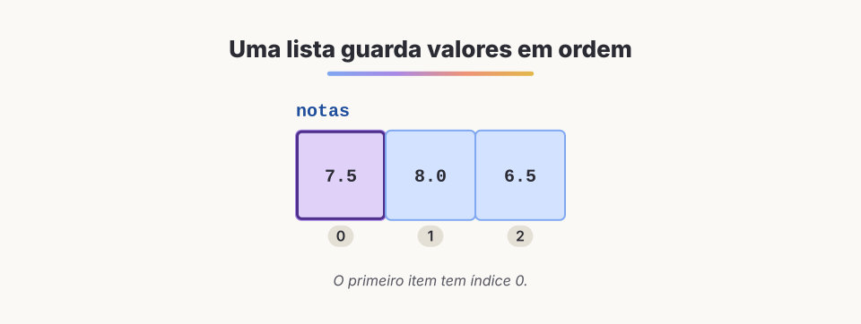

# 1. Listas

> 🗺️ **Neste capítulo:** como guardar várias notas numa variável só e contar quantas são. · ⏱️ ~20 min

## Listas

Guardar 40 notas em 40 variáveis seria impossível de manter.

**Uma lista guarda vários valores, em ordem, numa variável só.**

```python
notas = [7.5, 8.0, 6.5]
# len conta os itens: serve para dividir a soma depois
quantidade = len(notas)
print(quantidade)
```

Saída:

```text
3
```



> ⚠️ **Erro comum:** achar que o primeiro item é o de índice 1. Em Python, ele é o de índice 0.

## 🏋️ Pratique

Quantos itens tem a lista `[1, 2, 3, 4]`?

<details>
<summary>Ver resposta</summary>

4. `len` conta os itens, não o maior valor.

</details>

## 🧠 Revisão rápida

Qual é o índice do primeiro item de uma lista?

<details>
<summary>Ver resposta</summary>

0.

</details>

## 🤖 Estude com um tutor de IA

- "Faça 3 perguntas sobre listas em Python, uma de cada vez."

> ➡️ **Próximo passo:** somar os itens da lista com um laço.

## 📌 Resumo

| Item | Em uma frase |
| --- | --- |
| Lista | Vários valores, em ordem, numa variável |

## 📚 Fontes

- [The Python Tutorial](https://docs.python.org/3/tutorial/), conferido em 2026-11-20.
